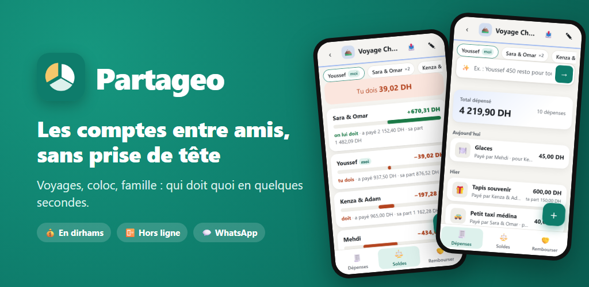

# 🤝 Partageo

Application web de partage des dépenses entre amis, en famille ou en colocation, pensée pour le Maroc.
Plus rapide et plus agréable que Tricount ou Splitwise.

👉 **Essayer : <https://partageo-app.netlify.app>**



## Fonctionnalités

- **Groupes** avec emoji et couleur ; participants avec **parts** (couple = 2, enfant = 0,5)
- **Saisie en langage naturel** : « Youssef 450 resto pour tous »
- **4 modes de répartition** : égal, parts, montants exacts, pourcentages, calculs au centime près
- **Soldes** visuels et **remboursements optimisés** (le moins de virements possible)
- **WhatsApp** : récap du groupe et rappels polis pré-rédigés
- **Partage de groupe par lien ou QR code**, sans serveur, avec fusion des versions
- **Sauvegarde** : export / import JSON
- **PWA** : installable, fonctionne **hors ligne**
- Montants en dirhams (`1 234,50 DH`), interface en français, mode sombre automatique

## Lancer le projet

Aucune installation, aucun outil de compilation :

- **Rapide** : double-clic sur `index.html` (sans mode hors ligne ni installation).
- **Complet** (hors ligne + installation) : dans ce dossier, lance
  ```
  python -m http.server 8000
  ```
  puis ouvre <http://localhost:8000>.

## Tests

- **Automatiques** : ouvre la console du navigateur (F12) et tape `Partageo.tests.run()`.
- **Manuels** : suis la checklist [`TESTS.md`](TESTS.md).

## Structure

```
index.html            page unique de l'application
style.css             apparence (thème clair / sombre)
sw.js                 service worker (hors ligne) — augmenter VERSION à chaque mise à jour
manifest.webmanifest  installation (nom, icônes, captures)
confidentialite.html  politique de confidentialité
js/
  core.js             socle commun et mini-cadre de tests
  money.js            argent en centimes, format « 1 234,50 DH »
  store.js            sauvegarde locale, import / export, fusion
  split.js            répartition d'une dépense (4 modes)
  settle.js           soldes et remboursements optimisés
  parser.js           saisie en langage naturel
  share.js            messages WhatsApp
  qr.js               générateur de QR code (sans bibliothèque)
  link.js             liens de partage compressés
  ui.js, app.js, …    interface
store/                éléments et guide de publication Google Play
```

## Publication

Voir [`store/GUIDE-GOOGLE-PLAY.md`](store/GUIDE-GOOGLE-PLAY.md).

## Confidentialité

Aucune donnée n'est envoyée à un serveur : tout reste sur l'appareil de l'utilisateur.
